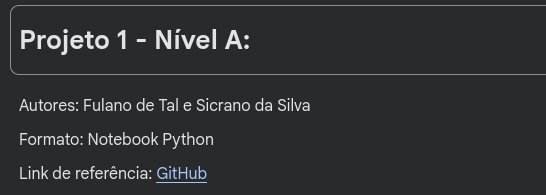
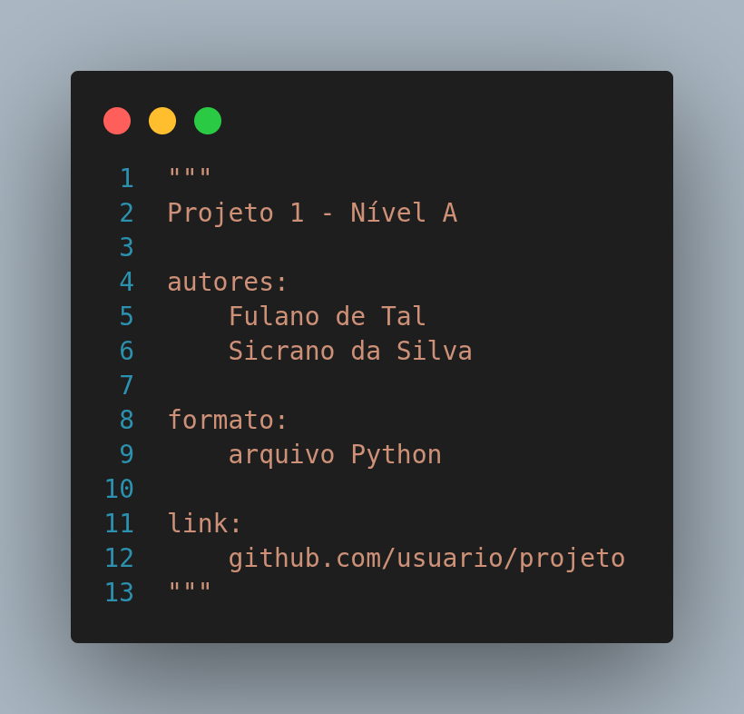

# **Projeto do Minicurso Python**

Para a última atividade do minicurso, temos um projeto para o portfólio dos alunos. Aqui vão os pré-requisitos de livre escolha:

**Quantidade de alunos:**
- Individual
- Dupla
- Trio

**Formato do projeto:**
- Arquivo `.py`
- Notebook `.ipynb`

**Tipo de projeto:**
- Nível iniciante
- Nível médio
- Nível avançado
- Autoral

## **Instruções:**

Ao iniciar o projeto, colocar cabeçalho como comentário, em caso de arquivo `.py`, ou com um bloco de texto, em caso de notebook. Veja os exemplos: 





É possível fazer a entrega para auxílio pelo email: [luis.gustavomartins@ufpe.br](mailto:luis.gustavomartins@ufpe.br).

Coloque uma **descrição** no projeto, especialmente para projetos autorais, o que seu código faz, quais as entradas, quais as saídas, quais os métodos utilizados...

## **🟢 Projetos de Nível Iniciante:**

### **🟢 Iniciante 01 - Sorteio de Dados de RPG**

Leia quantos lados tem o dado e mostre o resultado de três lançamentos, a soma e a média. Considere que os dados de RPG são apenas os dados:

- **D4** (4 lados)
- **D6** (6 lados)
- **D8** (8 lados)
- **D10** (10 lados)
- **D12** (12 lados)
- **D20** (20 lados)

**Conceitos:**

- Biblioteca `random`
- Soma
- Média

> **Observação:** como a saída é aleatória, use `random.seed(42)` no início do programa para conferir com os exemplos abaixo.

**Exemplo 1**
```
Quantos lados tem o dado?
> 20
Lançamentos: 4, 1, 9
Soma: 14 | Média: 4.67
```

**Exemplo 2**
```
Quantos lados tem o dado?
> 6
Lançamentos: 6, 1, 1
Soma: 8 | Média: 2.67
```

### **🟢 Iniciante 02 - Geometria de Polígonos e Poliedros**

Leia a quantidade de dimensões do elemento (2 ou 3). Depois leia o objeto, suas propriedas e a característica que o usuário deseja calcular (entre perímetro `P`, área `A`, volume `V` ou todas as informações `T`). Assuma os seguintes objetos:

**2D**

- `Círculo r`
    - `r`: Raio
- `TriânguloE l` (equilátero)
    - `l`: Lado
- `TriânguloI lado ladoRepetido` (isósceles)
    - `lado`: Lado que não se repete
    - `ladoRepetido`: Lado que se repete
- `Quadrado l`
    - `l`: Lado do quadrado
- `Retângulo a b`
    - `a`, `b`: Lados do retângulo
- `Losango D d`
    - `D`: Diagonal maior
    - `d`: Diagonal menor
- `Paralelogramo b h`
    - `b`: Base
    - `h`: Altura

**3D**

- `Esfera r`
    - `r`: Raio
- `Cubo l`
    - `l`: Lado do cubo
- `Paralelogramo a b c`
    - `a`, `b`, `c`: Lados do paralelogramo
- `PirâmideT l h` (base triangular)
    - `l`: Lado da base
    - `h`: Altura da pirâmide
- `PirâmideQ l h` (base quadrada)
    - `l`: Lado da base
    - `h`: Altura da pirâmide

**Conceitos:**

- Entrada de múltiplos dados
- Operações aritméticas
- Estrutura condicional

> **Observação:** Atenção às condições, uma vez que não é possível calcular o volume de um polígono.
> **Observação:** Caso seja necessário utilizar a constante `pi`, o valor utilizado foi da biblioteca `math`.

**Exemplo 1**
```
Dimensões do objeto:
> 2
Insira o objeto:
> Círculo 2.5
Insira as características:
> T
Perímetro: 15.71
Área: 19.63
```

**Exemplo 2**
```
Dimensões do objeto:
> 3
Insira o objeto:
Cubo 10
Insira as características:
A
Área: 1000.00
```

**Exemplo 3**
```
Dimensões do objeto:
> 4
Impossível calcular
```

**Exemplo 4**
```
Dimensões do objeto:
> 3
Insira o objeto:
> Quadrado
Objeto 3D não encontrado
```

### **🟢 Iniciante 03 - Conversor de Tempo**

Faça um código que receba uma quantidade inteira de segundos e converta o tempo para `minutos`, `horas`, `dias`, `semanas`, `meses` e `anos`.

**Conceitos:**
- Operação de resto de divisão e divisão inteira.
- Estrutura condicional

> **Observação:** Você pode considerar `1 mês = 4 semanas`.

**Exemplo 1**
```
Quantidade de segundos:
> 60
1 min 0 s
```

**Exemplo 2**
```
Quantidade de segundos:
> 604801
1 semana 0 dias 0 h 0 min 1 s
```

**Exemplo 3**
```
Quantidade de segundos:
> 2678399
4 semanas 2 dias 23 h 59 min 59 s
```

### **🟢 Iniciante 04 - Decodificador de Cores do Resistor**

Leia as três primeiras faixas de cor de um resistor e mostre o valor da resistência. Se alguma cor for inválida, mostre uma mensagem de erro. Veja a tabela como referência:

| Cores    | Valor numérico |
| :------- | :------------: |
| Preto    | 0              |
| Marrom   | 1              |
| Vermelho | 2              |
| Laranja  | 3              |
| Amarelo  | 4              |
| Verde    | 5              |
| Azul     | 6              |
| Violeta  | 7              |
| Cinza    | 8              |
| Branco   | 9              |

**Conceitos:**

- Dicionário
- Operador `in`
- Estrutura condicional

> **Desafio:** Mostrar em Ω, kΩ ou MΩ conforme o valor.

> **Observação:** Regra do valor:

$R = (1ª \times 10 + 2ª) \times 10^{3ª}$

**Exemplo 1**
```
Cores das 3 faixas (separadas por espaço):
> vermelho vermelho marrom
Resistência: 220 Ω
```
 
**Exemplo 2**
```
Cores das 3 faixas (separadas por espaço):
> marrom preto laranja
Resistência: 10 kΩ
```
 
**Exemplo 3**
```
Cores das 3 faixas (separadas por espaço):
> azul rosa preto
Erro: cor 'rosa' não existe na tabela.
```

### **🟢 Iniciante 05 - Classificador de IMC com Histórico**

Leia nome, peso e altura de várias pessoas até o usuário digitar `fim`. Para cada uma, calcule o IMC e a classificação. No final, mostre uma tabela com todos. Siga a tabela abaixo como exemplo:

| Faixa                             | Classificação     |
| :-------------------------------- | :---------------: |
| $\mathrm{IMC} \lt 18.5$           | Abaixo do peso    |
| $18.5 \leq \mathrm{IMC} \lt 25$   | Normal            |
| $25 \leq \mathrm{IMC} \lt 30$     | Sobrepeso         |
| $\mathrm{IMC} \geq 30$            | Obesidade         |

**Conceitos:**
- Estrutura condicional
- Esturtura de repetição
- Lista, dicionários

> **Observação:** Siga a expressão abaixo.

$\mathrm{IMC} = \frac{\mathrm{peso}}{\mathrm{altura}^{2}}$

**Exemplo**
```
Nome (ou 'fim'):
> Ana
Peso (kg):
> 60
Altura (m):
> 1.65
Nome (ou 'fim'):
> Bruno
Peso (kg):
> 95
Altura (m):
> 1.80
Nome (ou 'fim'):
> fim
 
Nome   | IMC   | Classificação
Ana    | 22.04 | Normal
Bruno  | 29.32 | Sobrepeso
```


## **Projetos de Nível Médio:**

### **Médio 06 - Calculadora de Datas**

Crie um menu com duas operações: (1) calcular quantos dias há entre duas datas e (2) somar uma quantidade de dias a uma data. As datas são digitadas no formato DD/MM/AAAA. É proibido usar os módulos datetime, calendar ou time; toda a lógica do calendário deve ser sua.

- **Validação:** rejeitar formato errado, mês fora de 1–12 e dia inexistente no mês (ex.: 31/04, 29/02/2025).

**Conceitos:**
- Estrutura condicional
- Estruturas de repetição

> **Dica:** transforme cada data em um "número de dias" contado a partir de uma data de referência (ex.: 01/01/0001). A diferença entre duas datas vira uma subtração. Para somar dias, avance dia a dia ou mês a mês com um while.

> **Desafio:** mostrar o dia da semana do resultado. Referência: 12/10/2026 é uma segunda-feira.

**Exemplo 1 — diferença entre datas**
```
(1) Dias entre datas
(2) Somar dias
(0) Sair
> 1
Data inicial (DD/MM/AAAA):
> 12/10/2026
Data final (DD/MM/AAAA):
> 25/12/2026
Entre 12/10/2026 e 25/12/2026 há 74 dias.
```
 
**Exemplo 2 — ano bissexto**
```
(1) Dias entre datas
(2) Somar dias
(0) Sair
> 1
Data inicial (DD/MM/AAAA):
> 01/02/2024
Data final (DD/MM/AAAA):
> 01/03/2024
Entre 01/02/2024 e 01/03/2024 há 29 dias (2024 é bissexto).
```
 
**Exemplo 3**
```
(1) Dias entre datas
(2) Somar dias
(0) Sair
> 2
Data (DD/MM/AAAA):
> 12/10/2026
Dias a somar:
> 100
12/10/2026 + 100 dias = 20/01/2027
```
 
**Exemplo 4**
```
(1) Dias entre datas
(2) Somar dias
(0) Sair
> 2
Data (DD/MM/AAAA):
> 20/02/2024
Dias a somar:
> 15
20/02/2024 + 15 dias = 06/03/2024
```
 
**Exemplo 5**
```
(1) Dias entre datas
(2) Somar dias
(0) Sair
> 1
Data inicial (DD/MM/AAAA):
> 29/02/2025
Erro: 29/02/2025 não existe (2025 não é bissexto).
Data inicial (DD/MM/AAAA):
> 31/04/2026
Erro: abril tem apenas 30 dias.
Data inicial (DD/MM/AAAA):
> 2026-10-12
Erro: use o formato DD/MM/AAAA.
```
 
**Exemplo 6 - Com o desafio incluso**
```
(1) Dias entre datas
(2) Somar dias
(0) Sair
> 2
Data (DD/MM/AAAA)
> 12/10/2026
Dias a somar:
> 100
12/10/2026 + 100 dias = 20/01/2027 (quarta-feira)
```

### **Médio 07 - Sistema de Notas da Turma**

Leia os dados de uma turma, onde em cada linha, temos os dados de nome, matrícula, 1ª nota, 2ª nota, 3ª nota e 4ª nota. Calcule a média de cada aluno e inclua "Aprovação" (média ≥ 7), "Recuperação" (3 ≤ média < 7) e "Reprovação" (média < 3). Ignore as notas que estão fora do intervalo [0, 10], caso não obedeça a condição, repita o pedido da linha. Se a matrícula se repetir, a entrada não pode ser aceita.

Ao inserir `-1`, o programa deve encerrar a entrada de dados e escrever os dados em um arquivo CSV, conforme o padrão abaixo:

```csv
matricula1, nota1_1, nota1_2, nota1_3, nota1_4, media1, "Situação1"
matricula2, nota2_1, nota2_2, nota2_3, nota2_4, media2, "Situação2"
...
```

Por fim, mostre na tela a média da turma, quantidade de aprovados, de recuperação e reprovados e o nome de aluno de maior média.

**Conceitos:**
- Entrada de múltiplos dados
- Estrutura condicional
- Estrutura de repetição
- Coleções
- Arquivos

> **Observação:** também é possível salvar o arquivo no formato TXT. Por convenção, o CSV é utilizado pela compatibilidade com o Python e programas como Excel e Google Planilhas.

**Exemplo 1**
```
Dados do aluno 1:
> Sicrano 123 8.5 6.0 2.5 9.0
Dados do aluno 2:
> Beltrano 124 10.0 8.5 9.0 -1
Nota inválida! Insira novamente!
Dados do aluno 2:
> Beltrano 124 10.0 8.5 9.0 9.5
Dados do aluno 3:
> Fulano 125 1.0 5.0 8.0 10.0
Dados do aluno 4:
> -1
Média da turma: 7.25
Aprovados: 1
Final: 2
Reprovados: 0
```

### **Médio 08 - Criptografia de Arquivos**

Leia um arquivo de texto, criptografe ou descriptografe seu conteúdo com a **Cifra de César** e grave o resultado em outro arquivo. Na cifra, cada letra é deslocada `k` posições no alfabeto, voltando ao início depois do Z (com `k = 3`: A→D, B→E, …, X→A, Y→B, Z→C).

- **Regras:**
    - Maiúsculas continuam maiúsculas e minúsculas continuam minúsculas.
    - Números, espaços, pontuação e quebras de linha **não** são alterados.
    - Descriptografar é deslocar `-k` (ou `26 - k`).
    - A chave deve ser um inteiro de 1 a 25; caso contrário, peça de novo.
    - Se o arquivo de entrada não existir, mostre uma mensagem de erro sem travar o programa

- **Fórmula:** para uma letra maiúscula, `nova = chr((ord(letra) - ord('A') + k) % 26 + ord('A'))`; para minúscula, troque `'A'` por `'a'`.

**Conceitos:**
- Strings
- Arquivos

> **Observação:** a leitura e escrita de arquivos é tema da Aula 03; aqui basta o uso básico de `open`, sem funções ou classes.
> **Desafio:** criar o modo **(Q) Quebrar**, que tenta as 25 chaves possíveis e mostra a primeira linha do texto para cada uma, para o usuário descobrir a chave por força bruta.

**Entrada — `mensagem.txt`**
```
Ola, Mundo!
Python e muito legal.
Ataque ao amanhecer: 06h30.
```
 
**Exemplo 1 — criptografar**
```
Arquivo de entrada:
> mensagem.txt
(C) Criptografar ou (D) Descriptografar?
> C
Chave (1 a 25):
> 3
Arquivo de saída:
> secreto.txt
Linhas processadas: 3 | Letras convertidas: 43
Resultado gravado em secreto.txt
```
 
**Saída — `secreto.txt`**
```
Rod, Pxqgr!
Sbwkrq h pxlwr ohjdo.
Dwdtxh dr dpdqkhfhu: 06k30.
```

**Exemplo 2 — descriptografar (o resultado deve ser idêntico ao original)**
```
Arquivo de entrada:
> secreto.txt
(C) Criptografar ou (D) Descriptografar?
> D
Chave (1 a 25):
> 3
Arquivo de saída:
> recuperado.txt
Linhas processadas: 3 | Letras convertidas: 43
Resultado gravado em recuperado.txt
```

### **Médio 09 - Calculadora Simbólica com SymPy**

Crie um menu que leia uma expressão em `x` e permita: derivar, integrar, calcular limite, encontrar raízes e plotar a função. Cada operação deve ser uma função separada.

**Conceitos:**
- Estrutura de repetição
- Funções
- `sympy`
- `matplotlib`

**Exemplo**
```
Expressão em x:
> x**3 - 6*x**2 + 9*x

Escolha uma opção:
(1) Derivada
(2) Integral
(3) Limite
(4) Raízes
(5) Gráfico
(0) Sair
> 1
f'(x) = 3*x**2 - 12*x + 9

Escolha uma opção:
(1) Derivada
(2) Integral
(3) Limite
(4) Raízes
(5) Gráfico
(0) Sair
> 2
∫f(x)dx = x**4/4 - 2*x**3 + 9*x**2/2 + C

Escolha uma opção:
(1) Derivada
(2) Integral
(3) Limite
(4) Raízes
(5) Gráfico
(0) Sair
> 3
x tende a:
> 2
lim f(x) quando x → 2 = 2

Escolha uma opção:
(1) Derivada
(2) Integral
(3) Limite
(4) Raízes
(5) Gráfico
(0) Sair
> 4
Raízes: [0, 3]

Escolha uma opção:
(1) Derivada
(2) Integral
(3) Limite
(4) Raízes
(5) Gráfico
(0) Sair
> 5
Insira o nome do arquivo:
> funcao
Gráfico salvo em funcao.png

Escolha uma opção:
(1) Derivada
(2) Integral
(3) Limite
(4) Raízes
(5) Gráfico
(0) Sair
> 0
```

### **Médio 10 - Cálculo de Moeda com API**

Faça um programa de converta moedas, utilizando a [AwesomeAPI](https://docs.awesomeapi.com.br/api-de-moedas), seja para dólar americano, euro ou bitcoin. Use como referência o link abaixo:

- **Referência:** https://economia.awesomeapi.com.br/last/USD-BRL,EUR-BRL,BTC-BRL

> **Dica:** Ao utilizar a biblioteca `requests` e `json`, você pode extrair os dados no formato de dicionário.

## **Projetos de Nível Avançado:**

### **Avançado 11 - Analisador de Sinais Senoidais**

Leia amplitude, frequência, fase (graus) e duração de um sinal senoidal. Gere o sinal com NumPy, calcule valor de pico, valor RMS e período, e salve o gráfico em `sinal.png`. Use a fórmula:

$v(t) = A \cdot sen(2 \pi ft + \phi)$

$V_{RMS} = \frac{A}{\sqrt{2}}$

**Conceitos:**
- Funções
- `numpy`
- `matplotlib`

> **Desafio:** faça operação de soma de duas senóides em um gráfico.

**Exemplo**
```
Amplitude (V):
> 10
Frequência (Hz):
> 60
Fase (graus):
> 0
Duração (s):
> 0.05
 
Período: 16.67 ms
Pico: 10.00 V
RMS calculado: 7.07 V (teórico: 7.07 V)
Gráfico salvo em sinal.png
```

### **Avançado 12 - Análise da Estatísticas da Câmara dos Deputados**

Crie um programa que analise estatisticamente dados da câmara dos deputados, como deputados por partido, qunatidade de mulheres por partido, quantidade de deputados por UF, etc.

Para isso, use o link de referência e faça a extração de dados com as bibliotecas `requests` e `pandas`.

- **Referência:** https://dadosabertos.camara.leg.br/api/v2/deputados

> **Dica:** utilize como referência o material do professor Fernando Masanori: [PyCidadania](bit.ly/pycidadania).

### **Avançado 13 - Microcontrolador com Python**

Crie um projeto com uma Raspberry Pi Pico no site [Wokwi](https://wokwi.com/), para simulação e prototipagem de ideias. A ideia é fazer um sistema de semáforo de trânsito, da seguinte maneira:

- **Sinal Vermelho:** 15 segundos.
- **Sinal Amarelo:** 5 segundos.
- **Sinal Verde:** 30 segundos.

Utilize os LEDs vermelho, amarelo e verde para fazer as conexões corretas.

> **Desafio:** adicione um botão para pedrestes. Quando acionado e o sinal estiver verde, ele deve reduzir o tempo do verde para 3 segundos, agilizando a passagem do pedestre.

> **Dica:** utilize a referência do site [MicroPython](https://micropython.org/).

### **Avançado 14 - Mineração de Texto na Câmara dos Deputados**

Construa um código que faça a leitura dos textos falados pelos deputados federais na câmara dos deputados. Para isso, utilize a URL de referência, onde:

- `id_deputado`: Código do deputado que pode ser encontrado em: [https://www.camara.leg.br/deputados/](https://www.camara.leg.br/deputados/).
- `data_inicio`: Data do início da busca.
- `data_final`: Data do fim da busca.
- `pagina`: Página referida da busca.

**Referência:** "https://dadosabertos.camara.leg.br/api/v2/deputados/{id_deputado}/discursos?dataInicio={data_inicio}&dataFim={data_final}&ordenarPor=dataHoraInicio&ordem=DESC&pagina={pagina}&itens=100"

> **Dica:** utilize como referência o material do professor Fernando Masanori: [PyCidadania](bit.ly/pycidadania).

### **Avançado 15 - Assistente Virtual**

Crie uma assistente virtual que leia o microfone e execute comandos no computador, seja para criação de pasta ou arquivos, executar programas, enviar mensagens, etc.

> **Dica:** utilize como referência o material da Rafa Ballerini: [Assistente Virtual](https://github.com/rafaballerini/AssistentePessoal)